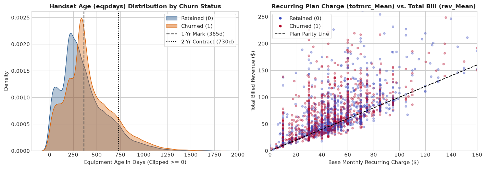
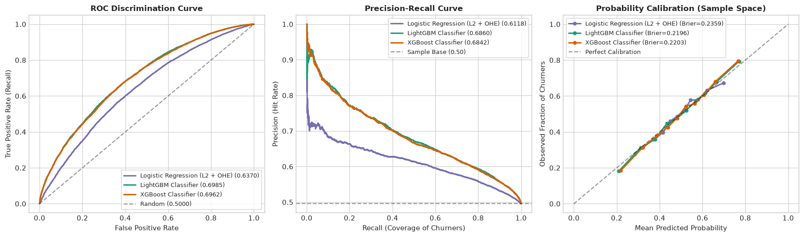
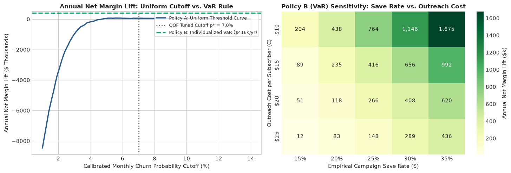

# Telecom-Churn-Revenue-Risk-Engine

**End-to-End Subscriber Churn Prediction, Bayes Prior Calibration, and Value at Risk Retention Engine**

An applied machine learning and decision optimization system built on 100,000 wireless telecommunications subscriber records (`Client.csv` + `Record.csv`, Cell2Cell benchmark). Instead of stopping at a binary classifier with an arbitrary 0.50 cutoff, this project bridges predictive modeling with financial unit economics by calibrating sample probabilities to real world monthly churn and routing high Value at Risk accounts into root cause retention playbooks.

---

## Key Results (Verified on 25,000 Holdout Test Accounts)

| Metric | Value | Notes |
| :--- | :--- | :--- |
| **Selected Model** | **LightGBM Classifier** | Regularized gradient boosted trees with native categorical splits |
| **Generalization Performance** | **0.6985 ROC-AUC** | 0.6963 5-fold OOF CV AUC, 0.6860 PR-AUC, 0.2196 Brier Score (matches 0.68 to 0.71 benchmark [1]) |
| **Top Decile Targeting Lift** | **1.60x** | 79.4% sample churn in Decile 1; Deciles 1 and 2 capture 29.7% of all churners |
| **Optimal Policy (VaR Rule)** | **3.42% Monthly Outreach** | 3,422 targeted accounts per 100,000 base via `EV_i = P_real * S * V_i - C > 0` |
| **Annualized Net Margin Lift** | **+$415,837 / year** | $1,031,825 gross margin preserved minus $615,988 OpEx (**67.5% Net ROI**, **7.2x** higher than uniform cutoff) |
| **Breakeven Save Rate** | **14.9%** | 10.1 percentage point safety buffer below the 25% base campaign save rate assumption |

---

## Project Architecture and Methodology

1. **Data Quality and Confounding Audit:** Resolves 1:1 relational join (`100,000 x 100`), clips 133 invalid negative equipment age entries (`eqpdays < 0`), and uncovers volume confounding in raw call drops (`8,160` dormant zero attempt accounts churn at `57.5%` with zero drops).
2. **Domain Feature Engineering:** Builds eight telemetry velocity and friction features (`eqp_tenure_ratio`, `mou_trend_3_vs_6`, `mou_trend_3_vs_life`, `rev_trend_3_vs_6`, `drop_failure_rate`, `completion_rate`, `overage_rev_ratio`, `custcare_rate`) alongside leakage free `OneHotEncoder` pipelines for linear baselines and native `category` handling for LightGBM and XGBoost.
3. **Bayes Prior Calibration:** Maps retrospective 50/50 sample probabilities (`49.56%`) onto the real world `2.0%` US wireless monthly churn prior via Bayes odds adjustment (Saerens et al., 2002 [4]).
4. **Individualized Value at Risk Optimization:** Scores each account's 24 month gross margin exposure (`V_i = ARPU_i * 24 * 0.65`) and routes flagged accounts (`EV_i > 0`) into four root cause playbooks:
   1. **Handset Upgrade Subsidy (5G):** `eqpdays > 365` (`1,373` accounts/mo, `$144.70` avg ARPU)
   2. **Tariff Plan Adjustment:** `overage_rev_ratio > 0.15` (`1,657` accounts/mo, `$187.06` avg ARPU)
   3. **Network Priority and Concierge Care:** `drop_failure_rate > 0.05` (`277` accounts/mo, `$141.75` avg ARPU)
   4. **Loyalty Data Bundle:** General high VaR accounts (`115` accounts/mo, `$115.37` avg ARPU)

---

## Visual Highlights

### Exploratory Data Diagnostics (Hardware Cliff and Billing Friction)


### Model Benchmarking and Probability Calibration


### Policy Comparison and 2D Sensitivity Analysis


---

## Repository Structure

```text
Telecom-Churn-Revenue-Risk-Engine/
├── assets/
│   ├── eda_hardware_billing.png
│   ├── model_evaluation_curves.png
│   └── var_sensitivity_analysis.png
├── slides/
│   └── Telecom_Churn_Revenue_Risk_Engine_Slides.pdf
├── telecom_churn_var_engine.ipynb
├── requirements.txt
├── .gitignore
└── README.md
```

---

## How to Run Locally

1. Clone this repository and install dependencies:
   ```bash
   pip install -r requirements.txt
   ```
2. Place the Cell2Cell / Company A dataset tables (`Client.csv` and `Record.csv`) inside a `telecom/` folder at the repository root (the raw CSV files are excluded via `.gitignore`).
3. Open and run `telecom_churn_var_engine.ipynb` in JupyterLab, VS Code, or Google Colab.

---

## References

1. **Neslin, S. A., Gupta, S., Kamakura, W., Lu, J., & Mason, C. H. (2006).** *Defection Detection: Measuring and Understanding the Predictive Accuracy of Customer Churn Models.* Journal of Marketing Research, 43(2), 204 to 211.
2. **CTIA / FCC / Statista Wireless Benchmarks (2024, 2025).** US mobile saturation and carrier monthly churn benchmarks.
3. **Reichheld, F., & Schefter, P. (2000).** *E-Loyalty: Your Secret Weapon on the Web.* Bain & Company / Harvard Business Review.
4. **Saerens, M., Latinne, P., & Decaestecker, C. (2002).** *Adjusting the Outputs of a Classifier to New a Priori Probabilities: A Simple Procedure.* Neural Computation, 14(1), 21 to 41.
5. **Ke, G. et al. (2017).** *LightGBM: A Highly Efficient Gradient Boosting Decision Tree.* NeurIPS; **Chen, T., & Guestrin, C. (2016).** *XGBoost: A Scalable Tree Boosting System.* KDD.
